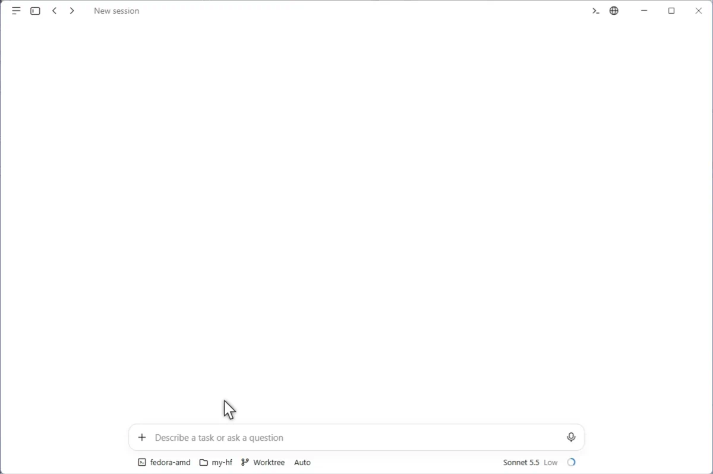

<h1 align="center">refs</h1>

<p align="center">Your agent's dependencies, checked out at the version you locked</p>

<p align="center">
  <a href="https://github.com/lukaprsina/refs-cli/releases/latest"></a>
  <a href="https://opensource.org/licenses/MIT"></a>
  <a href="https://github.com/lukaprsina/refs-cli"></a>
</p>

<br/>

<p align="center">
  
</p>

<br/>

Coding agents write library code from training data. When the library has changed since, you get calls to functions that no longer exist. `huggingface_hub` 2.0 removed `upload_large_folder`; a model trained before that writes it anyway.

`refs` fixes this at the source. It checks out the library's repo at the version in your lockfile, into `.references/`, and writes a short pointer into `AGENTS.md`. The agent reads the real source, docs and migration guides with its own read and grep tools.

```sh
refs add pypi:huggingface-hub   # pins the version from uv.lock
refs add npm:solid-js           # or cargo:serde, gh:owner/repo, any git URL
refs update                     # follow your lockfile after an upgrade
refs sync --check               # exit 3 if out of date, for CI
```

- 📌 **Your version** — pinned to the tag your lockfile uses (`uv.lock`, `Cargo.lock`, `package-lock.json`, `pnpm-lock.yaml`, `yarn.lock`, `bun.lock`, `poetry.lock`)
- 📖 **Source and docs** — migration guides and changelogs included, not a summary of them
- 🧠 **Always in context** — the pointer lives in `AGENTS.md`, so the agent doesn't have to decide to look something up
- 🔌 **No server** — no MCP server, no query API, no key
- 🪶 **Small** — shallow, sparse checkouts; `.references/` stays out of git
- 🔁 **Reproducible** — `refs.toml` and `refs.lock` are committed

| Instead of | Why `refs` |
|---|---|
| A docs MCP server or web search | The agent has to choose to call it, and often doesn't. The pointer in `AGENTS.md` is always there. |
| `llms.txt` or a docs snapshot | These usually describe the latest release. `refs` follows your lockfile. |
| Submodules or vendored copies | Sparse, shallow, and excluded through `.git/info/exclude`. |

## Install

Needs git 2.36 or newer (this excludes Ubuntu 22.04).

```sh
# macOS, Linux
curl --proto '=https' --tlsv1.2 -LsSf https://github.com/lukaprsina/refs-cli/releases/latest/download/refs-cli-installer.sh | sh
```

```powershell
# Windows
powershell -ExecutionPolicy Bypass -c "irm https://github.com/lukaprsina/refs-cli/releases/latest/download/refs-cli-installer.ps1 | iex"
```

Or, with a Rust toolchain: `cargo binstall refs-cli` (prebuilt binary) or `cargo install refs-cli` (builds from source). Update with `refs self update` (installer installs only).

Release artifacts carry GitHub artifact attestations: `gh attestation verify <file> -R lukaprsina/refs-cli`.

## Quick start

In a project with a lockfile:

```sh
refs add pypi:huggingface-hub
```

`refs add` looks up where the package lives, reads the version from your lockfile, checks out that tag, and updates `AGENTS.md`:

````markdown
<!-- BEGIN:refs -->

## Reference repos

```text
Source and docs for some dependencies are checked out read-only in `.references/`, pinned in `refs.lock`. …
```

### Ungrouped

```text
[huggingface_hub @ v2.3.0 587e09a] Client library to download and publish models, datasets and other repos on the huggingface.co hub. Packages: huggingface-hub. Start: docs/source/en/concepts/migration_v2.md.
```

<!-- END:refs -->
````

Commit `refs.toml`, `refs.lock` and `AGENTS.md`. Teammates and CI run `refs sync` to get the same checkouts.

Without a registry package, pass a git URL or `gh:owner/repo`. In a terminal `refs add` asks for what is missing; scripts pass flags and `--no-input`.

## Commands

| Command | Does |
|---|---|
| `refs init` | Create `refs.toml` and the git exclude rule |
| `refs add [url]` | Add a repo (`gh:`, `gl:`, `npm:`, `cargo:`, `pypi:` or a git URL), lock it, sync |
| `refs remove <id>` | Remove a repo |
| `refs disable` / `enable` | Switch a repo or group off or on |
| `refs list` | Show the repos; `--status` adds lock and checkout state |
| `refs sync` | Make checkouts and the `AGENTS.md` block match `refs.lock`; `--check` for CI |
| `refs update [id…]` | Move repos to the version your lockfile uses now, or a branch to its newest commit |
| `refs self update` | Replace this program with the latest release |

`refs <command> --help` has the flags. Exit codes: 0 ok, 1 error, 2 usage, 3 out of date (`--check`).

## Notes

- Some tools scan `.references/` because they don't read `.git/info/exclude`. `refs sync` says which of Prettier, ESLint, Black, Biome, markdownlint-cli2 and Zed need an exclude; refs never edits their files. Ruff, Oxlint, Oxfmt, ty, dprint, ripgrep, Helix, VS Code search and Neovim's pickers already skip it. In JetBrains, right-click the directory and Mark Directory as Excluded.
- `rg` skips `.references/` by default; pass the path (`rg foo .references/huggingface_hub`).
- Checkouts are read-only. `--force` discards local changes in one.
- Claude Code ignores `AGENTS.md` if a `CLAUDE.md` exists. Add `CLAUDE.md` to `agents_files` in `refs.toml`.

## Thanks

The registry lookups, the cleaning of repository URLs and the reading of `pnpm-lock.yaml` and `yarn.lock` build on [opensrc](https://github.com/vercel-labs/opensrc) by Vercel (Apache-2.0; see `NOTICE`).

## License

[MIT](LICENSE)
